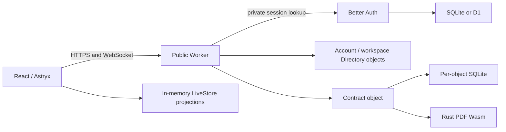

# Clausid — engineering architecture

Status: Living reference; engineering adoption in progress
Owner: Clausid maintainer
Verified against: 027772e and the current implementation; see the engineering tracker

## The problem the architecture solves

Clausid combines collaborative negotiation with a frozen signing artifact. Edits can arrive from
multiple accounts, reconnect after interruption and race a provider's review decision. A signature
must bind the document the person reviewed, not whatever a renderer would produce later.
This makes authorization, acknowledgement order and artifact identity architectural constraints.

There are two authoring paths. Native drafts are Tiptap documents backed by Yjs. Imported PDFs
retain their original bytes and accept bounded source-line replacements and drawings. Both paths
converge on a reviewed preview, a frozen version and a digest-bound signing record.
The source PDF and the native draft are not interchangeable storage formats.

## Runtime and trust boundaries

[Worker routing](../apps/worker/src/index.ts), `route`, authenticates API operations through
`internal('/internal/session')`, enforces origin on mutations/upgrades, and forwards the validated
account to private object handlers. Client roles and directory entries do not replace actor access
checks. `Contract.#role/#view` determines current access and filters signer-visible information.
The [identity reference](identity-and-access.md) documents the two identity adapters.

Directory object names have two roles: account ID names own per-account indexes, while
`workspace:<id>` names own workspace parties and invitations. These are instances of the same
class, not one shared database. `Contract` is a separate namespace keyed by contract ID.
The [workspace protocol](workspace-lifecycle.md) explains initialization and retry receipts.

## Native edit write path

1. [connectContract](../apps/web/src/connection.ts) listens to the local Y.Doc, assigns an update
   ID, queues the encoded update and sends it only on a writable connection.
2. `Contract.webSocketMessage` runs through `#serial`: one Promise chain orders asynchronous
   operations on the contract. A failed operation does not poison the next queue entry.
3. The actor verifies membership/session/draft state and parses `clientMessage`.
4. A repeated update ID receives an acknowledgement without applying the edit again.
5. The actor applies the candidate update to a temporary Y.Doc, verifies its size/completeness
   and checks the ProseMirror document in [validateDraft](../apps/worker/src/draft.ts).
6. `#save` uses one SQL transaction to write draft bytes, revision, update receipt and preview
   invalidation. Only after this transaction does the live actor document change and an ack leave.
7. Other clients receive the edit; each browser materializes authorized workflow views in
   [LiveStore](../apps/web/src/store.ts). Those projections are disposable, not a second durable log.

The queue of unsent browser updates belongs to the open tab. Closing the tab is not durable offline
storage. Reconnect resends the same IDs; freeze/access loss must expose unsaved changes rather
than showing Saved. Presence is transient. See [collaboration](collaboration-and-review.md).

## Review and PDF write paths

Native review anchors combine Yjs relative positions with the quoted passage. Approval resolves
both against current content, edits a disposable copy, and commits bytes and the decision together.
A stale quote or cross-paragraph replacement is a rejection, not a best-effort edit.

Imported PDF proposals identify source page/block/Unicode-scalar offset and expected text.
`Contract` uses [the Wasm adapter](../apps/worker/src/pdf-rewrite.ts) to plan before accepting a
proposal. Approval rebuilds negotiated bytes from the original plus approved edits, then applies
approved drawings. A failed rewrite does not commit the decision or replace the last artifact.
The browser's displayed digest prevents a proposal silently targeting an old rendering.
[PDF negotiation](pdf-negotiation.md) details coordinates, fit and unsupported cases.

## The signing boundary

`preview` verifies the current revision and unresolved review items, selects negotiated/source
bytes or renders a native draft, hashes them, and stores a preview expiring in 15 minutes.
`freeze` checks the exact preview ID/revision/expiry, copies those stored bytes into `frozen`, and
commits the version and invitations. It does not call the renderer.

A signature binds frozen version ID, digest, eligible verified identity, typed name, consent
version and time. A recent sign-in is required. `Signed` is reached after every required signer
has a record. The evidence ZIP contains the frozen PDF and a separate manifest. The PDF hash
establishes byte identity; it does not independently authenticate an arbitrary replacement manifest.
See [signing](signing-and-evidence.md) and [recovery](persistence-and-recovery.md).

## Boundary representations and failure channels

Shared [contracts](../packages/contracts/src/index.ts) contain public Zod inputs and output
representations. Private persisted records belong to the backend owner. Public and private data
must not be conflated merely because a field has the same name.

The public HTTP boundary converts `HttpError` to its status/message, validation failures to 400,
and unexpected exceptions to a generic 500. Private diagnostic logs omit document bodies and
credentials. Client HTTP errors retain their status. Invalid successful responses are protocol
failures, not successful mutations. Programmer invariants fail explicitly at their owning layer.

The boundary implementation uses schema-first HTTP helpers, parsed projections and staged Yjs
frames. A malformed success is a protocol error; pending edits survive a failed frame until explicit
retry. See [response parsing](../apps/web/src/response.ts), [protocol staging](../apps/web/src/protocol.ts)
and [recovery tests](../tests/connection.test.ts). Schemas prove shape, not authorization or transactionality.

## Deployment and recovery

The domain actors are shared between hosting adapters. VPS workerd proxies authentication to a
private Node process and serves built assets through its disk binding. Cloudflare's entry creates
the auth service with D1 and native email, and serves assets through `ASSETS`.
[Architecture](architecture.md) owns the topology/configuration comparison; deployment runbooks own
operator commands. Local checks do not provision hosted D1/email or qualify an HTTPS proxy.

Auth and application stores form one recovery point. The operations endpoint exports logical
object inventories under maintenance; the offline Rust CLI validates supplied archives/evidence.
Preserve namespace keys, object addressing, consent and frozen hashes across upgrades. A passing
local persistence test does not qualify every Compose or Cloudflare restore path.

## Tests and change ownership

- [Workflow browser tests](../tests/workflow.spec.ts): negotiation, permissions, freeze, signatures,
  PDF bytes and workspace behavior through actual workerd/auth services.
- [Account tests](../tests/account.spec.ts): verification, sign-out and reset behavior.
- [Persistence test](../tests/persistence.spec.ts): paired SQLite restore and known signed evidence.
- [PDF corpus](../packages/pdf-engine/tests/rewrite.rs): source-preserving replacements and rejections.
- [Verification tests](../tests/verification/workflow.test.ts) and [hook tests](../tests/verification/hooks.test.ts):
  routing, failure propagation, immutable Git snapshots and lifecycle retry semantics.

These are named evidence surfaces, not claims of exhaustive coverage. Add the negative case for
an affected boundary, then run its full profile. Source shape changes require producer/consumer
compatibility fixtures. New policy rules require a deliberately failing fixture as well as a
passing counterpart. UI behavior needs a real browser and rendered error/recovery evidence.

| Path                                                       | Owns                                                                                           |
| ---------------------------------------------------------- | ---------------------------------------------------------------------------------------------- |
| `apps/web/src/main.tsx`, `store.ts`                        | App composition and authorized workflow views                                                  |
| `apps/web/src/api.ts`, `connection.ts`                     | HTTP/auth transport and collaborative connection lifecycle                                     |
| `apps/web/src/app/`                                        | Astryx page templates and their UI sections; preserve the existing frames                      |
| `apps/web/src/contract-page.tsx`, `pdf-*`                  | Contract workflow composition and PDF interactions                                             |
| `apps/worker/src/index.ts`, `workspace-sharing.ts`         | Public routing, account directory, workspace sharing                                           |
| `apps/worker/src/contract.ts`                              | Contract access, collaboration, review, artifacts and signing state                            |
| `apps/worker/src/draft.ts`, `pdf.ts`, `pdf-rewrite.ts`     | Draft validation, PDF generation/markup and Wasm adapter                                       |
| `apps/worker/src/cloudflare.ts`, `web.ts`, `operations.ts` | Hosted auth, assets and maintenance adapters                                                   |
| `apps/auth/src/`                                           | Better Auth, private service, SMTP and SQLite schema                                           |
| `packages/contracts/src/`                                  | Shared Zod inputs and wire/domain types                                                        |
| `packages/pdf-engine/`                                     | Rust parser/rewrite core, Wasm bindings and workerd smoke fixture                              |
| `packages/ops/`                                            | Offline backup and signing-evidence verification                                               |
| `apps/website/`                                            | Independent Astro/Lumos website; not the Astryx app                                            |
| `scripts/checks/`                                          | Shared verification catalogue, change routing, documentation checks and subprocess lifecycle   |
| `scripts/agent/`, `.codex/`, `.claude/`, `.githooks/`      | Lifecycle/Git adapters and installation; reuse shared checks rather than maintain another gate |
| `tests/`                                                   | Unit tests and real-service Playwright workflows; `verification/` tests the gate itself        |
| `deploy/`, `wrangler.jsonc`, `compose.yaml`                | Deployment/configuration boundaries                                                            |

## Dependency rules

- Shared contracts must not depend on app UI or deployment implementations. Both browser and
  Worker consume them; boundary changes require producer/consumer compatibility evidence.
- UI delegates authorization and persisted mutations to the Worker. LiveStore and local Yjs state
  are not independent access authorities. Auth owns identities, not contract approval decisions.
- PDF negotiation goes through the Wasm adapter. Signing freezes reviewed artifacts rather than
  re-rendering them. Rust source and generated output are distinct; verify rebuilds before use.
- Keep hosting differences in adapters without forking domain behavior. Preserve SQLite/D1 and
  namespace compatibility explicitly when deploying.
- Literal imports/re-exports/dynamic imports and known workspace aliases are checked by the source-layer policy.
  Computed/runtime wiring and semantic ownership still need review. Split files along responsibilities
  when a task needs it; there is no arbitrary file-length gate.
