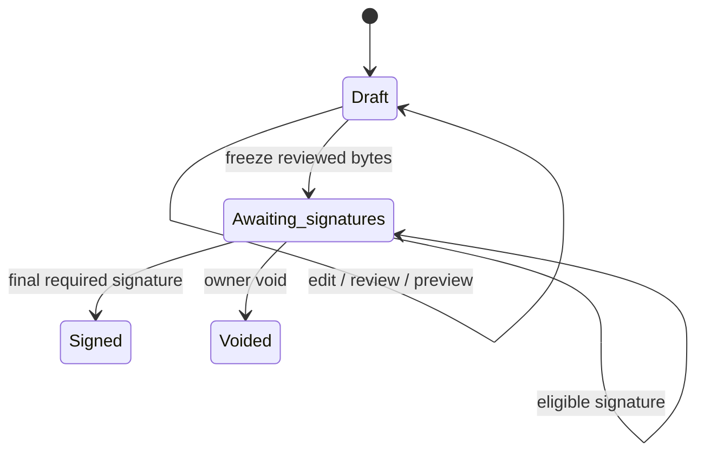

# Clausid contract surface

Status: Living reference; boundary migration in progress
Owner: Clausid maintainer
Verified against: 027772e plus current source; acceptance in the engineering tracker

The [shared module](../packages/contracts/src/index.ts) owns public schemas. Parse external
JSON before relying on these types. A type argument on `response.json<T>()` is not a parser.
The [program tracker](clausid-engineering-tracker.md) distinguishes schema implementation from
consumer migration and actual verification. This reference describes compatibility obligations;
it does not turn a pending boundary task into an enforced guarantee.

## Representation rules

- Workspace/contract request IDs are UUIDs. Better Auth account IDs are opaque strings, not UUIDs.
- Request emails normalize to lowercase. Response emails are validated without changing casing.
- JSON omission and explicit `null` are different representations. Older workspaces can omit
  metadata; document/project/first-contract fields also have legitimate nullable variants.
- Numeric revisions/times are finite nonnegative integers. Times such as createdAt are epoch
  milliseconds; signedAt/frozenAt/decision times are producer timestamp strings.
- SHA-256 values are 64 lowercase hex characters. Base64 is checked before binary decoding.
- Output objects accept additional fields but return only the declared consumed shape. Output
  parsing does not trim, coerce or add invented defaults. Unknown message kinds are rejected.
- Schema validation establishes representation, not membership, authorization or atomicity.

## Identity and access

The public Worker obtains `{id,email,name,createdAt,expires}` from the private session service.
The actor checks current membership for its own operation. Contract roles are owner/editor/signer;
workspace roles are owner/member. The provider is the workspace creator. These role spaces are
not interchangeable. See [identity and access](identity-and-access.md), requirements ACCESS-001–004.

A verified account may still lack access. Missing object/member operations deliberately return
unavailable responses. HTTP 401 means no valid verified session; 403 is an explicit forbidden
operation; 404 may hide an unavailable object. Signing can return 428 for an old sign-in.

## Workspace requests and responses

| Surface                  | Input / result                                                     | Important rules                                                                             |
| ------------------------ | ------------------------------------------------------------------ | ------------------------------------------------------------------------------------------- |
| `setupWorkspace`         | requestId, name, optional slug/project/document, description, team | Name 1–160; description ≤500; team 1–39, deduplicated; creator cannot invite self           |
| `workspaceDocument`      | name, base64 data                                                  | `.pdf` name ≤255; decoded application upload ≤1 MiB                                         |
| `workspaceSchema`        | id/name/description plus optional metadata                         | Preserve nullable slug/project/documentName/firstContractId; role/timestamps can be omitted |
| `workspacesSchema`       | workspace array                                                    | Each item is parsed; no new pagination or undocumented list-size limit                      |
| `customizeWorkspace`     | nonempty partial selection of explicit supported fields            | Assignee must be a current party; labels capped at 20 by the actor                          |
| `workspacePartiesSchema` | role, parties, invitations                                         | Party IDs are opaque account IDs; invitations are emails                                    |
| `workspaceAccessSchema`  | optional workspaceId, canManage                                    | UI capability is advisory; route/actor rechecks authority                                   |
| `invitationAckSchema`    | email                                                              | Manual invitation success is JSON, not an unvalidated void result                           |

Producer: public `route` and `workspaceSharing`; consumers: main dashboard, setup wizard,
workspace customization and parties dialog. Initialization reserves identity before exposing a
ready workspace; retries keep the same identity and source digest. See [workspace protocol](workspace-lifecycle.md).

Valid older workspace:

```json
{ "id": "a558c04c-a055-4c69-8a49-b7226e141416", "name": "Services", "description": "", "project": null, "firstContractId": null }
```

A response with `firstContractId: 3` is invalid. Absence of `createdAt` is not invalid simply
because newly created workspaces now emit it. Changing a workspace display status does not freeze
or sign a contract.

## Contract view and listing

`summarySchema` requires id, title, status and role. Optional fields are workspaceId, owner,
assignee, team, createdAt, updatedAt and hasSignatures. The listing is `summariesSchema`.
`partySchema` is `{id,email}`. The owner/editor/signer filtering in `Contract.#view` is authoritative.

`contractViewSchema` extends the summary with:

| Field             | Shape                             | Absence/null meaning                             |
| ----------------- | --------------------------------- | ------------------------------------------------ |
| revision          | nonnegative integer               | Required                                         |
| sourcePdf         | name, positive page count, digest | Omitted for native drafts                        |
| negotiatedPdf     | digest                            | Omitted until a negotiated artifact exists       |
| threads           | native thread array               | May be omitted, including filtered signer views  |
| outline           | outline correction array          | May be omitted                                   |
| annotations       | PDF annotation array              | May be omitted, including filtered signer views  |
| editors / invites | party arrays                      | Required; filtered views may return empty arrays |
| version           | id, digest, canSign, signers      | Required nullable; null means no frozen version  |
| version.signers   | email, signedAt                   | signedAt is nullable until that signer signs     |

A Draft with `version: null` is valid. Missing version, wrong status/role or a numeric editor
email is invalid. Do not manufacture an empty version to make a response parse.
Producer: `Contract.#view`; HTTP mutation/read routes and socket state share that view. Consumers:
contract page, dashboard listings, current capability/permission rendering and projections.

## Native edit and review protocol

`clientMessage` is an edit or presence discriminated union. An edit carries UUID id and base64
update (≤350,000 characters). Presence carries uint32 clientId/clock and nullable JSON cursor.
The actor additionally bounds the envelope (360,000 characters), cursor JSON (1,200 characters)
and accepted encoded draft (524,288 bytes). These are different representations and limits.

`reviewRequest` is `{requestId,change}`. Changes include add/reply/decide/outline. A native
anchor contains start/end Yjs relative-position base64 (≤256 characters each) and a quote
(1–800 characters). Replacement text is ≤800. Source text must still match on approval.
Limits are 120 threads, 240 total native replies and 500 outline corrections.

The account-scoped receipt binds request ID and payload digest. Same ID/same payload returns
current state; same ID/different payload is 409. Bytes, receipt, revision and preview invalidation
commit together. See [collaboration](collaboration-and-review.md), COLLAB-001–004.

## Server messages

| Discriminator | Required fields                              | Interpretation                                     |
| ------------- | -------------------------------------------- | -------------------------------------------------- |
| state         | contract; optional base64 draft              | Authorized workflow view and native state snapshot |
| edit          | id, revision, base64 update                  | Accepted update, not an arbitrary UI command       |
| ack           | id, revision                                 | Durable receipt for a pending update               |
| presence      | uint32 clientId/clock; nullable object state | Transient awareness                                |
| error         | message                                      | Operating failure                                  |

Producer: `Contract.#send/#broadcast/#publish`. Consumer: `connectContract`. Unknown discriminators,
wrong field shapes and invalid binary updates must not reach the live document. The pilot validates
an entire state message and stages its binary update before publishing either part.

A valid ack is `{"type":"ack","id":"opaque-update-id","revision":4}`. A string revision or
unknown type is a protocol failure. Output IDs mirror current producer representations; request
validation still requires the original UUID input rules. Do not replace endpoint-specific inputs
with the looser output compatibility schema.

## PDF proposal protocol

`pdfTextBlockSchema` contains zero-based page/block, text, a two-number baseline and optional
font_size from Rust. `pdfTextBlocksSchema` is its array. The public query page is one-based.

`pdfAnnotationAction` is add/visibility/reply/decide. Add can contain text, replacement or markup;
it may carry quote/location/displayedDigest/requestId. Markup has a tool and 2–256 normalized
points. A replacement identifies block, expected nonempty text and replacement (both ≤800).
The persisted edit adds zero-based page and Unicode scalar offset; the actor computes the offset
from exact source text, not a browser's UTF-16 selection index.

There are 60 annotations and 120 total PDF replies. Source range overlap with an approved edit
is 409; stale displayed digest is 409; ambiguous/unsupported target is 422. Failed approval does
not commit a decision or overwrite negotiated bytes. See [PDF negotiation](pdf-negotiation.md), PDF-001–005.

## Preview, freeze and signature protocol

`previewContract` carries revision and 1–20 unique normalized signer emails. It returns
`previewSchema: {id,digest}`. It stores exact selected bytes, signer set and a 15-minute expiry.
`freezeContract` carries previewId and must match the current unexpired revision-bound preview.

`signContract` requires versionId, 64-hex digest, name (1–120 trimmed), consent true and consent
version `1`. The actor supplies account/email/time itself. `signatureSchema` records those values
with the frozen version. A repeated matching signature does not append another record. Freshness
is ten minutes. See [signing](signing-and-evidence.md), SIGN-001–005.



The wire spelling is `Awaiting signatures`. The diagram identifier does not define an alternate
status value. Frozen content is not editable as a draft. A signed record cannot be draft-deleted.

## HTTP result categories and private data

Application API helpers require a schema for both used and intentionally ignored results. Successful
204 operations use an explicit empty schema. JSON successes must match the route's result schema.
An HTTP failure retains its status and a parsed `{error}` message or safe fallback. Malformed
successful data is a protocol error and cannot publish a new projection. Aborts remain cancellation.

Private persisted actor records, socket attachments and internal service payloads are parsed beside
their backend owner. Their schema is not a public response API. Preserve legitimate legacy fields
and stored bytes; malformed recovery input must not trigger an automatic destructive reset.

## Evidence and review

[Boundary fixtures](../tests/validation.test.ts), [workflow](../tests/workflow.spec.ts),
[account](../tests/account.spec.ts), [persistence](../tests/persistence.spec.ts),
[PDF corpus](../packages/pdf-engine/tests/rewrite.rs) and [operations](../packages/ops/src/main.rs)
are complemented by [HTTP/projection fixtures](../tests/boundaries.test.ts),
[WebSocket recovery](../tests/connection.test.ts) and [private-record compatibility](../tests/records.test.ts).
The tracker records the exact local tree and completed integration results. A source link or a document checker pass does not prove
semantic correctness. New wire fields must update producer, consumer, fixture and this reference.
