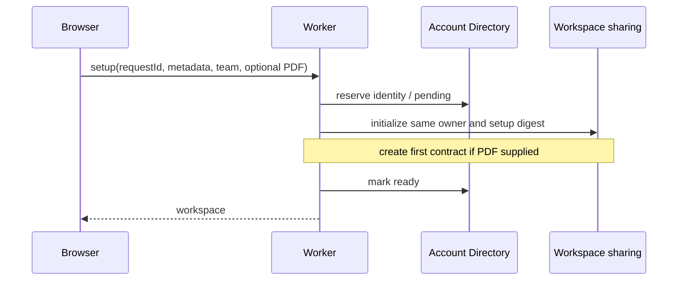

# Workspace lifecycle

- **WORKSPACE-001:** The Worker generates workspace IDs. An account-scoped request key reserves
  one initialization, including its ID and slug; retries resume the same initialization.
- **WORKSPACE-002:** The account directory exposes the workspace after the sharing object reserves
  the same owner. Ownership disagreements are errors, not automatic reassignment.
- **WORKSPACE-003:** An uploaded original PDF remains distinct from negotiated and frozen versions.
  Empty workspaces are supported and do not imply a document exists.
- **WORKSPACE-004:** Existing IDs, links and invitations survive compatible upgrades. Migration
  and ownership audit failures must be resolved before traffic reopens.

Status: Living reference
Owner: Clausid maintainer
Verified against: 027772e plus the engineering implementation; see tracker

## Reservation and visibility protocol

The browser supplies an account-scoped `requestId`; the public Worker generates the workspace ID.
`Directory.fetch` stores request-to-workspace identity, metadata and the optional slug. A unique slug
conflict is 409. Names are limited to 160 characters, descriptions to 500, slugs to 63. Setup requires
1–39 unique invitee emails and rejects inviting the creator. Upload is optional.

The public setup route reserves the account-directory entry, initializes `workspace:<id>` with the
same owner and optional document digest, creates a first PDF contract if supplied, and marks the
reservation ready. Listings exclude incomplete reservations. A repeated request resumes initialization
rather than allocating another workspace. Reusing a setup with another original document is a conflict.
An existing owner disagreement is unavailable; initialization never transfers ownership automatically.

The sharing object owns parties, invitations and customization. The account Directory owns the
creator's listing and other accounts' access indexes. A temporary failure between them is recovered
by retrying the same request; these objects do not participate in one distributed SQL transaction.
The ready marker prevents an incomplete initialization being presented as a usable workspace.

## Metadata and membership

`Draft`, `Review`, `Negotiation`, `Signature`, `Active`, `Expiring`, `On hold`, `Closed` and
`Completed` are workspace display statuses. They do not drive the contract signing state machine.
Customization may change name, description, project, status, assignee or add a label. Assignees
must be verified workspace parties; label insertion is case-insensitive and capped at 20.

An empty workspace opens Canvas without a fabricated document. A first document may be added later.
Workspace and contract ownership/membership are distinct. The provider creates private drafts and
explicitly shares them with current workspace parties. Accepting a workspace invitation can attach
its first contract when available; a missing first contract is represented with `firstContractId: null`.
Older metadata may omit fields such as timestamps, role or document name. Output schemas must retain
those legitimate variants instead of requiring a newly created workspace shape everywhere.

## Deletion and recovery

Only an empty, unshared workspace can be deleted through the workspace path. The sharing object
marks deletion before asking the account Directory to remove metadata. A 409 from a nonempty directory
clears the deleting marker. Other temporary failures remain retriable; do not silently reassign IDs.
The original uploaded document and any first contract are separate records, not one overloaded blob.

Evidence: [public route and Directory](../apps/worker/src/index.ts),
[sharing operations](../apps/worker/src/workspace-sharing.ts),
[workflow tests](../tests/workflow.spec.ts), and [ownership migration procedure](vps-to-cloudflare.md).
Old IDs, invitation links and namespace identity are compatibility constraints. An operational
ownership audit or hosted restore is not established by a successful schema test.
